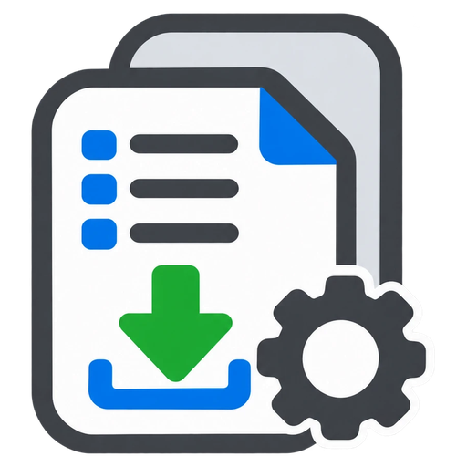

# 自动整理文件管理器 Download Butler

> 原名“下载管家”。升级安装后设置、密码本和移动记录都会保留。



Windows 下载文件夹的可视化管理器：**新文件下载完成后自动按类型和年月归档**，还能快速搜索、打开、移动和删除文件，并按天数或容量自动清理旧文件。

## 功能

- **自动整理**：监视“下载”文件夹（也可在设置中改为管理其他文件夹），新文件下载完成后归入
  `重要文件 / 安装包 / 压缩包 / 图片 / 视频 / 音乐 / 代码 / 其他文件`，再按 `年-月` 分子文件夹（可关闭）。
  分类和扩展名可在设置里自由增删改，也可以按**文件名关键词**分类（如移民身份文件、工作文件，见下方“分类规则”）。
  可选开启“整理散落的文件夹”：直接放在下载文件夹里的子文件夹（解压出来的、软件导出的）整个归入分类，里面的文件不拆散；
  驱动 / 软件安装包文件夹（含 setup.exe、.msi 等）归入“安装包”，程序 / 绿色软件文件夹（含多套一层的）和代码项目不搬动。
- **整个归档进来的文件夹在列表里只占一行**（显示里面的文件数），不再把几千个文件逐个列出；搜索也会匹配文件夹里面的文件名。
  **双击文件夹在应用内打开**，可以逐层进入，Backspace / Alt+← / 标题旁的返回按钮回到上一级。
- **最近添加**：左侧菜单最上方单独的彩色入口，列出最近到达这台电脑的文件（按到达时间，不是修改时间），快速找到刚下载的东西；
  时间范围默认 30 天，可选 24 小时 ~ 1 年（右键该按钮，或“外观 → 列表显示”）。
- **分析文件夹**（右键“清理”或右键某个文件夹）：把整个归档进来的文件夹分成“建议删除 / 可以考虑删除 / 可以理顺 / 建议保留”：
  空的、只有垃圾的、与原文件夹完全相同的副本建议删除；旧安装包、压缩包还在的解压文件夹、一年没动的大文件夹可以考虑删除；
  放错分类的安装包移到“安装包”、多套了一层的文件夹提出来（可在移动记录里撤销）；程序 / 绿色软件 / 代码项目始终建议保留。
- **清理垃圾文件**（单击左侧“清理”；右键有更多选项）：扫描整个文件夹（包括散落的子文件夹），列出 Thumbs.db / .DS_Store、macOS 的 `._` 文件和 `__MACOSX`、
  Office 残留的 `~$` 锁文件、过期的 `.tmp`、7 天没进展的未完成下载、0 字节空文件、空文件夹，
  以及“文件名带 (1) / 副本、内容与原文件完全相同”的重复下载。逐项确认后移入回收站；受保护分类里的空文件和副本不会列出。
  - 扫描在后台进行，不会卡住界面。
  - 代码项目和程序文件夹（含 `.git`、`.venv`、`node_modules`、`package.json`、`pyproject.toml`、`.sln`，或同时有 exe 和 dll）整个跳过，里面的内容不会列出。
  - “空文件夹”和“0 字节文件”只在下载文件夹本层、分类文件夹及其“年-月”子文件夹里判断，不深入你自己的文件夹结构。
  未下载完的文件会自动跳过：支持 Chrome / Edge / Firefox / Safari / Opera、迅雷、FDM、aria2、
  uTorrent、qBittorrent、BitComet 等的临时文件和控制文件。下载完成后默认等 10 秒再整理（可在设置中调整），
  方便直接在浏览器里“打开”或“在文件夹中显示”。
- **浏览与搜索**：按分类浏览；显示系统图标与图片缩略图；按日期分组；多关键词搜索（Ctrl+F，回车打开第一个结果）。
- **排序与筛选**：点表头按名称 / 分类 / 大小 / 时间排序，再点一次切换正序 / 倒序；可按时间范围和文件大小筛选。
- **文件操作**：打开、打开所在位置、重命名（F2；与已有文件重名时可一键保存为“名字 (1)”）、**快速加后缀**（右键 → 快速加后缀，可多选，如 `报告.pdf → 报告_已签字.pdf`；后缀列表可自定义，`{date}` 会换成当天日期）、**快速更改扩展名**（右键 → 更改扩展名，如 `.rar → .zip`，常用列表可自定义；只改名字，不转换内容）、移动到分类或任意文件夹、复制路径、删除（Del，进回收站可还原）；可直接把文件拖到其他程序。
- **压缩 / 解压**：右键文件即可压缩成 ZIP / 7Z / TAR.GZ / TAR.XZ，可选压缩级别、密码（AES-256 或 ZipCrypto）、加密文件名、压缩后删除原文件；
  解压支持 zip / 7z / rar / tar.* / iso 等及分卷压缩包，可选解压位置（智能 / 同名文件夹 / 当前文件夹 / 其他文件夹）、同名文件处理（重命名 / 覆盖 / 跳过，覆盖的旧文件进回收站）、完成后在应用内打开解压出的文件夹（不弹出资源管理器）、解压后把压缩包移到回收站；压缩包在分类文件夹里时，解压出来的文件自动放进各自的分类（视频进“视频”，不留在“压缩包”里）。分卷压缩包的每一卷（.zip.001、.z01、.r00 等）都会整理进“压缩包”。
  有密码时弹窗输入；常用密码可存进**密码本**（用 Windows 账户 DPAPI 加密保存），解压时自动依次尝试。在后台进行，有进度条，可随时取消。
  装了 [7-Zip](https://www.7-zip.org/) 时自动使用它（格式最全）；没装时用内置引擎（zip / tar；rar、7z 只能解开没有密码的）。
- **自动清理**：定期清理下载到本机超过 N 天的文件，或在总量超过 X GB 时从最旧的开始清理；可设置受保护的分类（默认保护“重要文件”）。
  - 只移入回收站：放不进回收站的文件（网络盘、U 盘、超过回收站容量）一律跳过，绝不永久删除。
  - 受保护的文件本身已超过容量阈值时，不删除任何文件，只提醒。
  - 不会跟随符号链接 / 目录联接删除下载文件夹以外的文件；清理在后台线程运行，不卡界面。
- **外观**：深色 / 浅色主题；自定义背景图片及其可见度；自动从背景图提取强调色，并自动调整明暗保证文字清晰；可调模块与窗口不透明度。
- **左侧菜单**：最上面是文件夹选择；标题栏的三个图标切换菜单为常驻展开、自动（鼠标靠近展开，离开后收起）或常驻折叠。
- **帮助中心与新手教程**：标题栏右上角的“?”（或按 F1）按主题说明每个功能怎么用，可搜索；第一次打开时有逐步高亮讲解的新手教程，可在帮助中心或“设置 → 记录与关于”重新查看。
- **整理多个文件夹**：除了下载文件夹，还可以整理桌面、移动硬盘上的文件夹等（规则更保守，不影响程序读取文件，见下方“管理的文件夹”）。
- **移动记录与一键撤销**：每次整理 / 移动都有记录，可以撤销某一次，或撤销某个时间点之后的全部，文件移回原处、绝不覆盖。
- **后台运行**：关闭窗口后缩到系统托盘；可开机自启。
- **版本更新**：“设置 → 常规 → 版本更新”可选 **自动更新**（后台下载，窗口缩到托盘或最小化、没有进行中的任务时自动安装并重新运行）、**手动更新**（默认；发现新版本时提醒，可跳过某个版本）或不自动检查；“设置 → 记录与关于 → 关于 → 检查更新”随时手动检查。
  新版本从本项目 GitHub Releases 下载，核对 SHA-256 摘要一致后才安装。

## 与「格式转换器」联动（可选）

[格式转换器](https://github.com/RonganBai/Universal-File-Format-Converter)（[下载安装包](https://github.com/RonganBai/Universal-File-Format-Converter/releases/latest)）是另一个独立的小工具，批量转换图片、文档、表格和视频格式。两个软件可以只装其中一个；装了格式转换器后，自动整理文件管理器会自动多出：

- 文件右键菜单「转换为 ▸」：列出格式转换器悬浮球上的常用格式，点一下即在后台转换（视频只显示视频格式和动图）。「更多格式…」会在格式转换器主窗口中打开这些文件。
- 「设置 → 相关应用」显示格式转换器是否已安装，并提供下载链接。

没装格式转换器、或它已被卸载时，这些菜单不会出现。转换结果保存到格式转换器自己的输出文件夹，不会被当成新下载再次整理。

## 性能

- 不做定时轮询：使用系统的文件夹变化通知，没有新文件时后台 CPU 占用为 0。
- 隐藏在托盘时不刷新界面；开机后台启动约 15 秒后预先准备列表，之后从托盘打开窗口约 0.3 秒。
- 缩略图在后台线程按目标尺寸解码，并缓存到 `%LOCALAPPDATA%\DownloadButler\thumbs`。

## 安装

在 [Releases](../../releases) 下载 `DownloadButler-Setup-x.y.z.exe` 运行即可。安装在当前用户目录，不需要管理员权限。

- 设置与背景图保存在 `%APPDATA%\下载管家`，卸载时保留。
- 覆盖安装 / 更新时，安装程序会自动结束正在运行的旧版本并等它完全退出，再检查其他占用安装文件的程序（交互安装时列出供关闭）。如果旧版本以管理员身份运行而无法结束，会提示先从托盘退出，不会装到一半失败。
- 系统要求：Windows 10 / 11 x64。

## 从源码运行 / 构建

```powershell
python -m pip install -r requirements.txt
python download_manager.py            # 直接运行
python download_manager.py --min      # 只在托盘中启动
python tests/run_all.py               # 运行测试（全部在临时目录中进行，不动真实文件）
powershell -ExecutionPolicy Bypass -File .\build.ps1   # 打包 exe + 生成安装包（需 Inno Setup 6）
```

安装包输出到 `installer\Output\`。`requirements.txt` 只含运行依赖，打包工具在 `requirements-build.txt`。
推送到 GitHub 后，CI 会在 Windows 上运行测试并构建安装包（`.github/workflows/ci.yml`）。

## 分类规则

在 **设置 → 分类规则** 中可以修改分类名、扩展名，或新增 / 删除分类，保存后立即生效（不需要重启）：

- 每个分类可以填**扩展名**、**文件名关键词**，或两者都填：
  - 只填关键词：任何类型的文件，文件名含任一关键词就归入（如“移民身份文件”：`护照, passport, 签证, I-20, OPT`）。
  - 关键词 + 扩展名：两个条件都满足才归入（如“扫描件”：扩展名 `pdf`，关键词 `scan, 扫描`）。
  - 关键词分类优先于只按扩展名的分类；英文关键词按整词匹配（`opt` 不会误中 `adopt`），`_ - .` 和空格都算分隔符。
- “添加常用分类”提供 **移民身份文件 / 工作文件 / 财务票据 / 学习资料** 模板，可修改关键词；添加的模板自动设为受保护分类。
- 规则修改后，已整理的文件不会自动挪动；可点“按当前规则重新整理已有文件”，预览后再移动（整个归档进来的文件夹不会被拆散；放错分类的安装包文件夹会整个移到“安装包”，其他文件夹保持原位）。
- 给分类改名时，对应的文件夹会一起改名；删除分类不会删除文件夹和里面的文件。
- 同一个扩展名出现在多个分类时，排在前面的分类优先；没有匹配的文件放进“其他文件”。
- **规则方案**：主文件夹用“主文件夹规则”；其他文件夹默认相同，也可以选用独立的方案（在“管理的文件夹”里点“为它新建规则…”）。
  在“分类规则”顶部切换正在编辑的方案，可以新建、重命名、删除，并**导出 / 导入** `.json` 规则文件（导入为新方案，或载入到编辑器检查后再保存）。
- “恢复默认规则”可回到下面的内置规则：

| 分类 | 扩展名 |
|---|---|
| 重要文件 | pdf doc docx xls xlsx ppt pptx txt md csv wps et dps rtf odt |
| 安装包 | exe msi msix appx apk dmg iso |
| 压缩包 | zip rar 7z tar gz bz2 xz |
| 图片 | jpg jpeg png gif bmp webp svg heic ico |
| 视频 | mp4 mkv avi mov wmv flv webm |
| 音乐 | mp3 wav flac aac m4a ogg |
| 代码 | py js html css json java c cpp ps1 bat sh |
| 其他文件 | 其余所有文件 |

## 管理的文件夹

默认管理系统的“下载”文件夹。在 **设置 → 管理的文件夹 → 主文件夹** 中可以换成其他文件夹（例如浏览器单独设置的下载目录）。
为避免误操作，不能选择磁盘根目录、用户主目录本身、系统 / 程序目录以及 AppData 等应用数据目录。

### 其他文件夹

在 **设置 → 管理的文件夹 → 其他文件夹** 中可以再添加桌面、文档、移动硬盘上的文件夹等。为了不影响任何程序读取文件，规则比主文件夹更保守：

- 只整理最外层、**加入之后新出现**的文件，放进其中的 `已整理\分类\年-月`；从不进入子文件夹。已有的文件点“整理现有文件…”预览确认后才动。
- 跳过快捷方式、程序、脚本、配置和数据文件（`.lnk .exe .ini .json .db` 等，可修改）、隐藏 / 系统文件、OneDrive 等“仅在线”的云盘文件、未下载完的文件。
- 不能添加游戏库、程序目录、代码项目、整个 OneDrive，以及和已管理的文件夹重叠的位置；文件夹之后变成项目时自动停止整理。
- 默认不参与自动清理，可单独开启；移动硬盘拔出时显示“未连接”，插回后自动恢复。
- 每个文件夹可以使用独立的分类规则方案。主页顶部的文件夹选择框可以只看某一个文件夹（左侧分类随之切换），最外层未整理的文件显示在“未整理”里。

### 移动记录与撤销

**设置 → 移动记录** 列出每次自动整理、立即整理、移动到、按规则重新整理的文件（保存在 `%APPDATA%\下载管家\moves.jsonl`）。
可以“撤销这次”或“撤销这次及之后的全部”：文件按相反顺序移回原位置，原位置已有同名文件时自动改名、绝不覆盖；撤销移回的文件之后不会再被自动整理。
